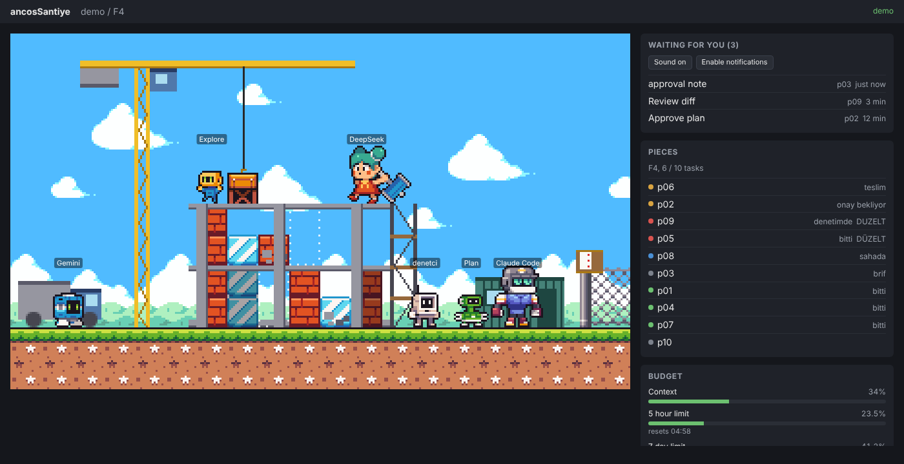

# ancosSantiye

Watch your AI coding agents build your project as a pixel art construction site.



Every Claude Code session becomes a worker on the site. Subagents, reviewers and outside suppliers get their own characters. The building grows floor by floor as your project moves through its stages, and pieces show up as bricks, glass and crates. Anything that waits for you (an approval, a review) lands on the board by the gate and in the "Waiting for you" panel, with a sound and a browser notification if you want them.

It runs on your machine only: a small .NET server on `127.0.0.1` and one page in your browser. No accounts, no cloud, no telemetry.

## What you get

- **The site:** a chief, workers, a subcontractor, an inspector, an architect and a supplier truck, each tied to a real agent role. Workers climb to the roof while they work, wait on the ground when idle, and walk off when their session ends.
- **Side panels:** what is waiting for you, every piece and its status, your context window and plan limits (5 hour and 7 day), and the last events.
- **Notifications:** one beep and one browser notification per new gate, never on page load.
- **Folder lane (optional):** watch a folder with a markdown status file and delivery files, so work done outside Claude Code (other models, other tools, you) shows up too.
- **Commit and push from the screen (optional, off by default):** pick files, write a message, confirm. See [Commit and push](#commit-and-push-from-the-screen).

## Requirements

- [.NET 10 SDK](https://dotnet.microsoft.com/download)
- [Claude Code](https://code.claude.com/docs) for live data. Without it you can still open the demo.
- A modern browser (the page is plain ES modules and Canvas 2D, nothing to build)

## Install

From a release (download `AncosSantiye.<version>.nupkg` from [Releases](https://github.com/ancoesat/ancosSantiye/releases) into a folder first):

```bash
dotnet tool install --global AncosSantiye --add-source <folder with the .nupkg>
```

From source:

```bash
git clone https://github.com/ancoesat/ancosSantiye
cd ancosSantiye
dotnet run --project src/AncosSantiye
```

## Quick start

1. Start the server and open the page:

   ```bash
   ancos-santiye
   ```

   Then open http://127.0.0.1:5170. Want to see it first? Open http://127.0.0.1:5170/?demo=build. Other demo stages: `empty`, `r1`, `r2`, `r3`, `build`, `done`.

2. Connect Claude Code (once):

   ```bash
   ancos-santiye hooks install
   ```

   This adds HTTP hooks and the status line to `~/.claude/settings.json`. It backs the file up first (timestamped `.bak` next to it), keeps every hook and setting you already have, and keeps an existing status line instead of replacing it. Want to see what it adds before it adds it? `ancos-santiye hooks print`. To remove it: `ancos-santiye hooks uninstall`. Another settings file: `--settings <path>`.

3. Start a Claude Code session. A worker walks onto the site.

If the server is not running, Claude Code carries on as usual: the hooks give up after 2 seconds and the status line says `santiye off`.

## Profiles

Without a profile you get the built-in skin, Claude Code data only, and a read-only screen. A profile is a small JSON file (comments allowed):

```jsonc
{
  "skin": "grafxkid",              // a built-in skin, or use "skinPath" for your own folder
  "folderLane": {
    "directory": "../_phase-logs",  // relative paths start at the profile file's folder
    "statusFile": "my-project-status.md",
    "project": "my-project",
    "intervalSeconds": 1
  },
  "actions": { "enabled": false, "repos": [] }
}
```

```bash
ancos-santiye --profile path/to/profile.json
```

A missing or broken profile stops the server with one clear line. It never falls back silently.

### Folder lane

The status file is a markdown table. The server reads it when it changes and turns differences into events (stage, piece status, review verdicts, gates). A row whose status is `onay bekliyor` ("waiting for approval") is a gate. See [`profiles/example-status.md`](profiles/example-status.md):

```markdown
Stage: F2

| id | piece | lane / model | env / risk | status | reviewer | fix rounds | notes |
|---|---|---|---|---|---|---|---|
| my-project-001 | Login page | claude / opus | draft / mid | bitti | ONAY | 0 | |
| my-project-003 | Pricing copy | reader / gemini | draft / low | onay bekliyor | | 0 | |
```

A file half written by an editor never clears your gates: an empty read after a full one is skipped and read again on the next tick.

Delivery files in the same folder, named `<project>-<number>-gemini.md` or `<project>-<number>-studio.md`, bring the supplier truck. Only files that appear after the server starts count.

### Custom skins

Copy `src/AncosSantiye/skins/grafxkid`, change the sprites and `skin.json` (sheet paths, frame sizes, which character plays which role), and point `skinPath` at your folder. Only use sprites whose license lets you use them; do not commit packs that forbid redistribution.

## Commit and push from the screen

Off by default. Turn it on per profile, and list the repos it may touch:

```json
"actions": { "enabled": true, "repos": ["C:/code/my-project"] }
```

A Commit panel appears. You tick files one by one (there is no "all"), write a message, and the browser asks you to confirm with the file list and the message in front of you. Push has its own button and its own confirmation.

What it will and will not do:

- Only files that `git status` lists at that moment. Other staged changes stay out of the commit.
- The message goes to git as written, quotes and new lines included. A pre-commit hook still runs; if it refuses, your index is put back as it was.
- Push is a plain `git push` to where git says it goes. If git cannot name the target, nothing is pushed. No force, no branch switching, no new branches, no pull, merge, amend or reset.
- One git action at a time.

How it is guarded: the endpoints do not exist unless actions are on. Every request must come from the page's own origin, be JSON, and carry a random token made at every start. A page on another site cannot get through (the custom header forces a CORS preflight that the server never answers), and a foreign `Host` header is refused, which stops DNS rebinding.

**Known limit:** a program running on your machine can read the token the same way the page does. A program with a shell can also just run `git`, so this is no new power, but if you let AI agents run commands, keep actions off unless you need them, or deny `127.0.0.1:*/actions/*` and `127.0.0.1:*/config` in the agent's permission rules.

## Security and privacy

- The server only listens on loopback (`127.0.0.1` or `localhost`) and refuses to start on any other address.
- Write endpoints for Claude Code refuse requests that carry an `Origin` header (a browser) and anything that is not JSON.
- Events never carry code, diffs, file contents or secrets. Only names, ids, counts and statuses. Long values are cut at 200 characters.
- Events are kept as one NDJSON file per day in `~/.ancos-santiye/events`. Delete the folder whenever you like.

## How it is built

- ASP.NET Core minimal API on .NET 10, Server-Sent Events, `System.Text.Json`. No NuGet packages in the app.
- A pure reducer turns events into the site state; the server sends a snapshot, then live events.
- Plain ES modules and Canvas 2D at 320x184, scaled by whole numbers. No npm, no bundler, nothing to build.
- xUnit tests, including real git repos for commit and push. `bash scripts/check.sh` is the gate: a dash check, build, tests.

The design log, every problem met on the way and how it was fixed, is in [DEVLOG.md](DEVLOG.md).

## Known gaps

- Hooks and the status line always point at port 5170, even if you start the server with `--urls` on another port.
- OpenCode and other tools have no adapter yet; use the folder lane for them.

## License

Code: [MIT](LICENSE). Sprites: CC0 packs by GrafxKid, credited in [ASSET-LICENSES.md](ASSET-LICENSES.md).
